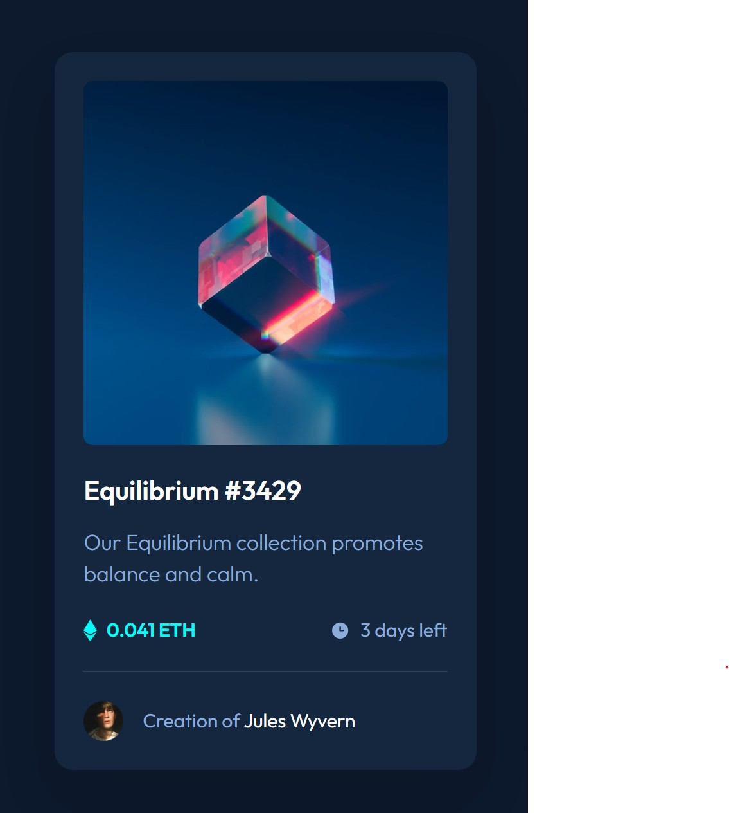

# Frontend Mentor - NFT preview card component solution

This is a solution to the [NFT preview card component challenge on Frontend Mentor](https://www.frontendmentor.io/challenges/nft-preview-card-component-SbdUL_w0U). Frontend Mentor challenges help you improve your coding skills by building realistic projects.

## Table of contents

- [Overview](#overview)
  - [The challenge](#the-challenge)
  - [Screenshot](#screenshot)
  - [Links](#links)
- [Getting started](#getting-started)
- [My process](#my-process)
  - [Built with](#built-with)
  - [What I learned](#what-i-learned)
  - [Continued development](#continued-development)
  - [Useful resources](#useful-resources)
- [Author](#author)

## Overview

### The challenge

Users should be able to:

- View the optimal layout depending on their device's screen size
- See hover states for interactive elements

### Screenshot



### Links

- Solution URL: [github.com/jonghwascript/nft-preview-card](https://github.com/jonghwascript/nft-preview-card)
- Live Site URL: _to be added after deployment_

## Getting started

The source lives in `src/` and Gulp builds it into `dist/`.

```bash
npm install
npm run build   # cleans dist, then compiles HTML, SCSS, and static files
npm run dev     # builds, serves dist with Browsersync on port 3000, and watches src
```

| Path | Purpose |
| --- | --- |
| `src/pages/index.html` | Page markup |
| `src/scss/abstracts/` | Design tokens (colors, font sizes, breakpoints) and mixins |
| `src/scss/layout/_every-layout.scss` | Layout primitives (`l-stack`, `l-cluster`, `l-frame`, ...) |
| `src/scss/components/_nft-card.scss` | Card component styles |
| `src/images/` | Optimized assets provided by the challenge |

## My process

### Built with

- Semantic HTML5 markup
- [Sass](https://sass-lang.com/) modules (`@use`) with design tokens
- CSS custom properties
- Flexbox and CSS Grid
- [Every Layout](https://every-layout.dev/) primitives for spacing and alignment
- BEM naming (`c-` components, `l-` layouts)
- Mobile-first workflow
- [Gulp](https://gulpjs.com/) build pipeline
- [Outfit](https://fonts.google.com/specimen/Outfit) from Google Fonts

### What I learned

**Stacking an overlay with CSS Grid instead of absolute positioning.** The image and a `::after` pseudo-element share the same grid cell, so the hover overlay needs no extra HTML and no `position: absolute`.

```scss
.c-nft-card__artwork {
  display: grid;

  &::after {
    content: '';
    grid-area: 1 / 1;
    place-self: stretch;
    background: color.change($cyan-400, $alpha: 0.5)
      url('../images/icon-view.svg') center no-repeat;
    opacity: 0;
  }

  &:is(:hover, :focus-visible)::after {
    opacity: 1;
  }
}
```

`place-self: stretch` turned out to be essential. The layout primitive on the same element sets `align-items: center`, which collapsed the empty pseudo-element to a height of `0`. I only caught this by measuring the element, not by looking at the code.

**Styling a parent from a child state with `:has()`.** Hovering or focusing the artwork also highlights the title and creator name:

```scss
.c-nft-card:has(.c-nft-card__artwork:is(:hover, :focus-visible)) {
  .c-nft-card__title,
  .c-nft-card__creator-name {
    color: $cyan-400;
  }
}
```

**Custom properties inherit.** `l-cluster` reads its gap from `var(--space, 1rem)`. Inside an `l-stack` card, it inherited the stack's `1.5rem` instead of falling back to `1rem`, so the creator row needed an explicit `data-gap="normal"`.

**`rem` makes text scale, which can expose new overflow.** Switching font sizes from `px` to `rem` lets the text follow the user's browser font size. At 200% text size on a 320px screen, a single long word ("Equilibrium") pushed the card wider than the viewport. `overflow-wrap: anywhere` on the card fixed it.

**Translating Figma Auto Layout.** Auto Layout maps closely to Flexbox, but copying it frame by frame produces a `div` for every frame and fixed widths. I followed its intent (direction, gap, alignment) and expressed it with semantic HTML, layout primitives, and flexible sizes such as `min(100%, 21.875rem)`.

### Continued development

- Compare the result 1:1 with the Figma design, including whether the creator name should be a link with its own hover state and whether the avatar needs a white border
- Verify the layout in Firefox and with screen readers; checks so far were done in Chromium
- Deploy the site and add the live URL

### Useful resources

- [Every Layout](https://every-layout.dev/) - The layout primitives used for stacking, clustering, and fixed-ratio media.
- [MDN: `:has()`](https://developer.mozilla.org/en-US/docs/Web/CSS/:has) - Reference for selecting an element based on its descendants.
- [MDN: `overflow-wrap`](https://developer.mozilla.org/en-US/docs/Web/CSS/overflow-wrap) - Explains the difference between `break-word` and `anywhere`.
- [The A11Y Project Checklist](https://www.a11yproject.com/checklist/) - Used to review alt text, focus styles, and reduced motion.

## Author

- Frontend Mentor - [@jonghwascript](https://www.frontendmentor.io/profile/jonghwascript)
- GitHub - [@jonghwascript](https://github.com/jonghwascript)
